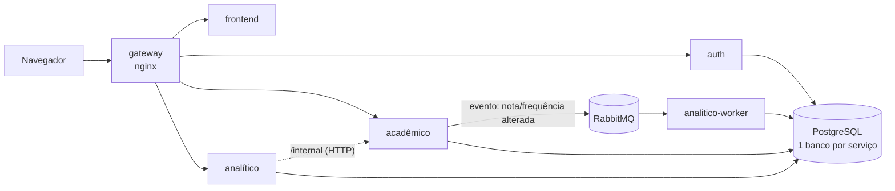

# SIMPA — Sistema Inteligente de Monitoramento e Predição Acadêmica

Projeto Integrador — 2º período de Inteligência Artificial — UniEVANGÉLICA.

Plataforma para registrar notas e frequência, calcular indicadores estatísticos, classificar risco acadêmico com justificativa e expor tudo por meio de uma API REST segura.

## Arquitetura

O SIMPA é dividido em serviços independentes, cada um no seu container e com o próprio banco ([D13](docs/decisoes.md#d13--arquitetura-em-serviços-e-não-monolito)). Tudo sobe com um único comando do Docker Compose.



| Container | Papel | Requisitos |
|---|---|---|
| `gateway` | Única porta de entrada; encaminha `/api/<serviço>/` e gera o `X-Request-ID` | RF12, RNF15 |
| `frontend` | Interface web em React (D12) | RF04, RF06, RNF11, RNF12 |
| `auth` | Login, emissão de JWT (RS256), usuários e perfis | RF09, D03, D15 |
| `academico` | Turmas, disciplinas, alunos, inscrições, notas e frequência | RF01–RF04, RF08, D10 |
| `analitico` | Indicadores, risco, gráficos e relatórios | RF05–RF07, RF11 |
| `analitico-worker` | Consome os eventos do acadêmico e recalcula o risco | RF03, D11, D14 |
| `postgres` | PostgreSQL 17 com `auth_db`, `academico_db` e `analitico_db` | RNF08, D16 |
| `rabbitmq` | Fila de eventos entre os serviços | D14 |

## Stack

| Camada | Tecnologia |
|---|---|
| Interface | React + Vite + TypeScript, Recharts, Lucide, fonte Inter |
| APIs | FastAPI + Pydantic |
| Persistência | SQLAlchemy + Alembic + PostgreSQL |
| Mensageria | RabbitMQ (pika) |
| Gateway | nginx |
| Autenticação | JWT RS256 (PyJWT) |
| Análise | pandas / numpy / matplotlib (entram na Fase 2) |
| Qualidade | pytest + ruff |
| Ambiente | Docker + Docker Compose |

## Como rodar

Pré-requisito: [Docker Desktop](https://www.docker.com/products/docker-desktop/) aberto.

```bash
# 1. Clonar e entrar
git clone https://github.com/Victorfiallho/simpa.git && cd simpa

# 2. Configuração: depois troque as senhas no .env
cp .env.example .env             # Windows: copy .env.example .env

# 3. Subir tudo (a primeira vez demora alguns minutos)
docker compose up --build -d

# 4. Popular com dados sintéticos (36 alunos, 2 turmas, notas e frequências)
docker compose exec academico python -m app.comandos.seed
```

O seed pode ser rodado mais de uma vez: se os dados já existirem, ele não faz nada.

### Usuários de demonstração

Em desenvolvimento, o auth cria um usuário de cada perfil (D03), todos com a senha `DEMO_SENHA` do `.env`:

| E-mail | Perfil |
|---|---|
| `admin@simpa.dev` | Administrador |
| `coordenacao@simpa.dev` | Coordenador |
| `ana.prof@simpa.dev`, `bruno.prof@simpa.dev`, `carla.prof@simpa.dev` | Professor |

Para usar a API pelo Swagger: faça `POST /login` em http://localhost/api/auth/docs, copie o `access_token`, abra http://localhost/api/academico/docs, clique em **Authorize** e cole o token.

Com tudo de pé:

| Endereço | O que é |
|---|---|
| http://localhost | Sistema (Visão geral e Alunos, por enquanto com dados de demonstração) |
| http://localhost/api/auth/docs | Swagger do auth |
| http://localhost/api/academico/docs | Swagger do acadêmico |
| http://localhost/api/analitico/docs | Swagger do analítico |
| http://localhost:15672 | Painel do RabbitMQ (usuário e senha do `.env`) |
| `localhost:5432` | PostgreSQL, para DBeaver/pgAdmin (só em desenvolvimento) |

Comandos úteis:

```bash
docker compose logs -f academico        # acompanhar os logs de um serviço
docker compose ps                       # ver o estado de cada container
docker compose down                     # parar tudo (os dados continuam salvos)
docker compose down -v                  # parar e APAGAR bancos, filas e chaves
```

Em desenvolvimento, o código de cada serviço é montado dentro do container e a API reinicia sozinha a cada alteração (`docker-compose.override.yml`). Só é preciso `--build` de novo quando mudar um `requirements.txt` ou `Dockerfile`.

### Testes e lint

Rodam fora do Docker, num ambiente virtual com as dependências dos três serviços:

```bash
python -m venv .venv
source .venv/bin/activate        # Windows: .venv\Scripts\activate
pip install -r requirements-dev.txt

ruff check .
ruff format --check .
cd services/academico && pytest      # repita para auth e analitico
```

### Gerar uma migração depois de alterar os models

As migrações são de cada serviço e rodam dentro do container dele:

```bash
docker compose exec academico alembic revision --autogenerate -m "descricao curta"
docker compose exec academico alembic upgrade head
```

O arquivo gerado aparece em `services/academico/migrations/versions/` (a pasta é montada no container). Revise antes de commitar. As migrações também são aplicadas automaticamente toda vez que o serviço sobe.

## Estrutura

```
docker-compose.yml           todos os containers
docker-compose.override.yml  ajustes de desenvolvimento (lido automaticamente)
gateway/nginx.conf           rotas do gateway
infra/postgres/init.sql      cria um banco por serviço
frontend/                    interface em React + Vite + TypeScript (ver frontend/README.md)
services/
  auth/                      ┐
  academico/                 ├ mesma organização interna:
  analitico/                 ┘
    app/
      main.py                FastAPI + /health
      core/                  configuração, banco, segurança (JWT), logs, respostas e erros
      models/                entidades (tabelas do banco do serviço)
      schemas/               DTOs de entrada/saída e validação (Pydantic)
      repositories/          acesso a dados; único lugar que fala com o banco
      services/              regras de negócio
      api/                   rotas HTTP (públicas e /internal)
      events/                publicação (acadêmico) ou consumo (analítico) de eventos
      clientes/              chamadas HTTP a outros serviços (acadêmico → auth)
      comandos/              comandos de terminal, como o seed (acadêmico)
    migrations/              migrações do Alembic do serviço
    tests/
    Dockerfile
    requirements.txt
docs/                        SRS, DER, decisões, UML, códigos de erro, roteiro de demonstração
```

## Documentação

- [Especificação de Requisitos (SRS v1.0.0)](docs/srs-v1.0.0.docx)
- [Enunciado do Projeto Integrador](docs/enunciado-pi.pdf)
- [Decisões técnicas](docs/decisoes.md)
- [DER](docs/der.md)
- [Diagramas UML (casos de uso, classes e camadas)](docs/uml.md)
- [Códigos de erro da API](docs/codigos-erro.md)
- [Roteiro de demonstração do Marco 1](docs/demonstracao-marco1.md)
- [Roadmap](ROADMAP.md)

## Equipe

| Integrante | Responsabilidades |
|---|---|
| _Nome_ | _ex.: serviço auth_ |
| _Nome_ | _ex.: serviço acadêmico_ |
| _Nome_ | _ex.: serviço analítico (estatística e risco)_ |
| _Nome_ | _ex.: frontend_ |
