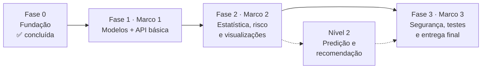

# Roadmap — SIMPA

Este documento organiza os próximos passos do SIMPA a partir do estado atual do repositório, do [SRS v1.0.0](docs/srs-v1.0.0.docx), das [decisões técnicas](docs/decisoes.md), do [DER](docs/der.md) e do [enunciado do Projeto Integrador](docs/enunciado-pi.pdf).

Cada fase corresponde a um **Marco** do enunciado. Cada tarefa indica os requisitos (RF/RNF) e as decisões (Dxx) que ela atende, o que já alimenta a matriz de rastreabilidade exigida pelo RNF13.

> **Como usar:** crie um *Milestone* no GitHub para cada Marco e transforme cada item com `[ ]` em uma *Issue* com a label do requisito (ex.: `RF07`). Marque `[x]` aqui quando o PR correspondente for aprovado.

---

## Visão geral

| Fase | Marco | Semanas (enunciado) | Foco | Status |
|---|---|---|---|---|
| 0 | — | 1–3 | Estrutura, SRS, DER, decisões | ✅ Concluída |
| 1 | Marco 1 | 4–7 | Models, migrações, CRUD, contrato da API | ⬜ A fazer |
| 2 | Marco 2 | 8–13 | Indicadores, risco, gráficos, relatórios | ⬜ A fazer |
| 3 | Marco 3 | 14–19 | Autenticação, RBAC, logs, testes, documentação final | ⬜ A fazer |

---

## Fase 0 — Fundação ✅

O que já existe no repositório:

- [x] Estrutura de pastas em camadas (`core`, `models`, `schemas`, `repositories`, `services`, `api`) — RNF01, RNF06
- [x] Configuração via `.env` com `pydantic-settings` — RNF04
- [x] Engine SQLAlchemy com `PRAGMA foreign_keys=ON` para SQLite — RNF08
- [x] Alembic configurado com `render_as_batch` e URL lida do `.env`
- [x] Ruff com regras de segurança (`S`) e pytest configurados — RNF02, RNF07
- [x] SRS v1.0.0, DER e registro de decisões D01–D11 — RNF05
- [x] Teste de sanidade

---

## Ajustes rápidos antes da Fase 1

Pequenas correções encontradas na leitura do repositório. Vale resolver primeiro porque são rápidas e evitam confusão na banca.

- [ ] **Unificar o nome do projeto.** O README usa *Sistema Inteligente de Monitoramento e **Predição** Acadêmica* e o SRS usa *Sistema **Integrado** de Monitoramento e **Performance** Acadêmica*. Escolher um e corrigir no outro (o nome do enunciado é o do README).
- [ ] **Separar as dependências.** O `requirements.txt` hoje inclui `pytest`, `ruff`, `pluggy`, `iniconfig` e `Pygments`, que são de desenvolvimento. Deixar só o necessário para rodar e manter as ferramentas no `requirements-dev.txt`, como o próprio README promete.
- [ ] **Adicionar as dependências que a stack anuncia e que ainda faltam:** `pandas`, `numpy`, `matplotlib` (análise), `argon2-cffi` ou `bcrypt` (hash de senha), `PyJWT` (token), `openpyxl` e `reportlab` (exportação). Podem entrar na fase em que forem usadas.
- [ ] **Criar `app/main.py`** com a instância do FastAPI e uma rota `GET /health`, para que `uvicorn app.main:app --reload` funcione e o README ganhe esse passo.
- [ ] **Preencher a tabela "Equipe"** do README com os 8 integrantes e suas responsabilidades.
- [ ] **Configurar CI no GitHub Actions** (`.github/workflows/ci.yml`) rodando `ruff check .` e `pytest` em todo push e PR. Isso prova o RNF02 e o RNF07 automaticamente.
- [ ] **Proteger a branch `main`**: merge só por PR com CI verde e ao menos 1 revisão.

---

## Fase 1 — Marco 1: Modelos e API básica

**Objetivo do Marco 1 (enunciado):** arquitetura definida, modelagem documentada, classes implementadas e API básica funcional de cadastro e consulta.

### 1.1 Modelos e banco — RNF08, D01, D02
- [ ] Criar os models SQLAlchemy das 9 entidades do DER: `Usuario`, `Turma`, `Disciplina`, `Aluno`, `Inscricao`, `Avaliacao`, `Frequencia`, `ResultadoRisco`, `LogRequisicao`
- [ ] Aplicar as restrições da tabela "Restrições que o banco deve garantir" do DER (`UNIQUE`, `CHECK`, `ON DELETE RESTRICT`)
- [ ] Usar `Numeric(4, 2)` para `nota`, `peso`, `media_final` e `frequencia_final` (D06: nada de `float`)
- [ ] Importar todos os models em `app/models/__init__.py` (o Alembic depende disso)
- [ ] Gerar e revisar a primeira migração: `alembic revision --autogenerate -m "cria tabelas iniciais"`
- [ ] Teste de integração: unicidade de matrícula e de `(aluno_id, disciplina_id)` e bloqueio de exclusão com histórico

### 1.2 Contrato da API e tratamento de erros — RF08, RF10, RNF02, RNF14
- [ ] Schema genérico de resposta com `status`, `mensagem`, `dados`, `erro`, `pagina`, `limite`, `total_registros`
- [ ] Exceções de domínio em `app/core/exceptions.py` (ex.: `RecursoNaoEncontrado`, `RegraDeNegocioViolada`, `DisciplinaEncerrada`)
- [ ] *Exception handlers* centralizados: validação → 400/422 com **campo, regra e código interno**; não encontrado → 404; erro inesperado → 500 **sem stack trace**
- [ ] Catálogo de códigos internos de erro em `docs/codigos-erro.md`

### 1.3 Schemas (DTOs) — RF01, RF02, RF03, RF10
- [ ] Schemas `Create`, `Update` e `Read` para cada entidade
- [ ] Validador de CPF com dígitos verificadores
- [ ] `frequencia_percentual` existe só no schema de saída (D02)
- [ ] Validação `0 ≤ faltas ≤ aulas_previstas` e `aulas_previstas > 0`

### 1.4 Repositórios — RNF01
- [ ] `BaseRepository` genérico (padrão *Repository*) com `obter`, `listar`, `criar`, `atualizar`, `inativar`
- [ ] Paginação, ordenação e filtros em todas as listagens (RF08)
- [ ] Nenhum outro módulo acessa a `Session` diretamente

### 1.5 Services e rotas CRUD — RF01, RF02, RF03, D10
- [ ] `turmas`, `disciplinas`, `alunos`, `inscricoes`, `avaliacoes`, `frequencias`
- [ ] `DELETE` faz exclusão lógica (status inativo), conforme os princípios gerais
- [ ] Bloquear criação, edição e exclusão de lançamentos em turma/disciplina `encerrada` (D10)
- [ ] Encerrar uma turma bloqueia as disciplinas vinculadas

### 1.6 Consulta integrada do aluno — RF04
- [ ] `GET /alunos/{id}` e `GET /alunos/matricula/{matricula}` com cadastro, notas e frequências
- [ ] Aluno inexistente → 404
- [ ] Indicadores e risco entram na resposta na Fase 2

### 1.7 Dados sintéticos — RNF04, RNF08
- [ ] `scripts/seed.py` gerando turmas, disciplinas, alunos, inscrições, notas e frequências **totalmente sintéticos**
- [ ] Incluir casos de propósito: aluno com média baixa, aluno com frequência baixa, aluno na fronteira (6,00 / 75,00%) e aluno sem dados (D09)

### 1.8 Documentação do Marco 1 — RNF05
- [ ] **Diagrama UML de casos de uso** em `docs/` (exigido pelo RNF05 e ainda ausente)
- [ ] **Diagrama UML de classes** em `docs/` (exigido pelo RNF05 e ainda ausente)
- [ ] Atualizar o README com o passo de seed e de subir a API (`/docs` do Swagger)
- [ ] Roteiro de demonstração do Marco 1 (cadastrar turma → disciplina → aluno → inscrição → nota → consultar aluno)

**✔ Pronto quando:** a API sobe, o Swagger mostra os CRUDs, o seed popula o banco, a consulta do aluno funciona e o CI está verde.

---

## Fase 2 — Marco 2: Módulo analítico

**Objetivo do Marco 2 (enunciado):** indicadores estatísticos, visualizações, integração dos cálculos à API e interpretação dos resultados.

### 2.1 Serviço de estatística — RF05, D05, D06, D07
- [ ] `services/estatistica.py` com média simples, média ponderada, mediana, variância, desvio padrão, maior e menor nota, frequência média
- [ ] Arredondamento com `Decimal` e `ROUND_HALF_UP` em 2 casas **antes** de qualquer comparação (D06)
- [ ] Variância populacional × amostral conforme D07, retornando `tipo_variancia`; `null` + "amostra insuficiente" quando n < 2
- [ ] Agregação por aluno, turma, disciplina e período letivo
- [ ] Testes unitários com valores calculados à mão

### 2.2 Serviço de risco — RF07, RNF09, D04, D08, D09, D11
- [ ] `services/risco.py` calculando o risco **por inscrição**; o aluno fica Em Risco se qualquer inscrição ativa estiver Em Risco (D04)
- [ ] Justificativa legível, citando disciplina, média e frequência (ex.: `"POO: média 4,50 (< 6,00) — media_baixa"`)
- [ ] Sinal de **Atenção** quando Sem Risco com média 6,00–6,99 ou frequência 75,00–79,99% (D08)
- [ ] Status **Indeterminado** para inscrição sem dados (D09)
- [ ] Gravar novo `ResultadoRisco` só quando a classificação mudar (D11)
- [ ] Testes obrigatórios: RF07 CA01, CA02, CA03 e as fronteiras 5,994 → Em Risco e 5,995 → Sem Risco

### 2.3 Integração com a API — RF03, RF04, RF05
- [ ] Recalcular o risco sempre que uma avaliação ou frequência for criada, alterada ou excluída
- [ ] Rotas de indicadores: `/indicadores/alunos/{id}`, `/indicadores/turmas/{id}`, `/indicadores/disciplinas/{id}`, `/indicadores/periodos/{periodo}`
- [ ] Rota de histórico de risco por inscrição
- [ ] Consulta integrada do aluno (RF04) passa a incluir indicadores e diagnóstico de risco

### 2.4 Visualizações — RF06, RNF09, RNF12
- [ ] **Registrar a decisão D12: qual será a interface** (ex.: Streamlit, templates Jinja2 no próprio FastAPI ou front separado). O RF04, RF06, RNF11 e RNF12 citam "interface", e isso ainda não foi decidido.
- [ ] Gráficos: histograma de notas, dispersão (frequência × média), barras por disciplina, linha de evolução, ranking e pizza de status
- [ ] Todo gráfico com título, eixos, legenda e texto explicativo
- [ ] Cores semânticas: vermelho = risco, amarelo = atenção, verde = sem risco, azul = informação
- [ ] Status sempre escrito junto da cor ("Em Risco"), nunca só a cor (RNF12)

### 2.5 Relatórios — RF11
- [ ] Filtros por período, turma, disciplina e status de risco
- [ ] Exportação em CSV, XLSX (`openpyxl`) e PDF (`reportlab`)
- [ ] Cabeçalho com data, hora e usuário que gerou
- [ ] CPF e e-mail mascarados nos arquivos exportados (RNF04)

### 2.6 Nível 2 — Predição e recomendação *(opcional, mas diferencia a nota)*
- [ ] **Decidir em grupo se o SIMPA vai para o Nível 2** e registrar como decisão
- [ ] Correlação entre frequência e média (Pearson) por turma e disciplina
- [ ] Regressão linear simples para tendência de desempenho (ex.: prever N2 a partir de N1 e frequência), implementada com álgebra matricial (`numpy`) para mostrar a ligação com Álgebra Linear
- [ ] Recomendações heurísticas a partir dos critérios violados (ex.: "frequência baixa → contato da coordenação")
- [ ] Explicar os limites do modelo (amostra pequena, dados sintéticos) na documentação e na apresentação
- [ ] `notebooks/` com a exploração estatística que justifica as escolhas

**✔ Pronto quando:** os indicadores e o risco aparecem pela API, os gráficos refletem o banco, os relatórios exportam nos 3 formatos e os testes de RF05 e RF07 passam.

---

## Fase 3 — Marco 3: Segurança, robustez e entrega final

**Objetivo do Marco 3 (enunciado):** API com autenticação e controle de acesso, segurança básica, logs, testes, documentação e relatório final.

> 💡 O enunciado deixa autenticação para a semana 14, mas as rotas da Fase 1 já podem receber uma dependência `usuario_atual` vazia. Assim, ligar o RBAC depois não exige reescrever as rotas.

### 3.1 Autenticação e RBAC — RF09, D03
- [ ] Hash de senha com Argon2 ou bcrypt (Restrição 1)
- [ ] `POST /auth/login` emitindo JWT com expiração e `role`
- [ ] Login inválido → 401 com mensagem genérica, sem dizer se foi o e-mail ou a senha (RF09 CA01)
- [ ] Rota protegida sem token → 401
- [ ] Dependências de autorização seguindo a tabela da D03
- [ ] Professor só lança e consulta dados das próprias disciplinas
- [ ] Só Admin reabre turma/disciplina encerrada (D10)
- [ ] Seed cria um usuário de cada perfil para a demonstração

### 3.2 Logs e auditoria — RF12, RNF16
- [ ] Middleware que gera um **Correlation ID** por requisição e devolve no cabeçalho de resposta
- [ ] Logs em JSON estruturado
- [ ] Gravação em `LogRequisicao` com `usuario_id`, rota, método, status, IP e tempo de resposta
- [ ] Nunca registrar senha, token ou CPF completo; teste automatizado que garante isso

### 3.3 Segurança de entrada — RNF15, RNF04
- [ ] Testes de SQL Injection (o ORM protege, mas o teste comprova)
- [ ] Sanitização contra XSS em campos de texto
- [ ] Proteção contra *Parameter Pollution* (parâmetros repetidos na query)
- [ ] CORS restrito às origens da interface
- [ ] Revisar se algum painel expõe CPF ou e-mail sem necessidade

### 3.4 Qualidade e desempenho — RNF03, RNF07, RNF10
- [ ] Documentar no OpenAPI as respostas 200, 201, 400, 401, 404 e 500 de cada rota
- [ ] Medir cobertura com `pytest-cov` e mirar nos services de estatística e risco
- [ ] Testes de contrato das principais rotas
- [ ] Índices nas FKs e colunas de filtro; medir se listagens paginadas ficam abaixo de 300 ms
- [ ] Refatoração final guiada pelo ruff e pela revisão em grupo

### 3.5 Documentação e apresentação — RNF05, RNF13
- [ ] `docs/rastreabilidade.md`: matriz ligando cada RF/RNF a models, services, rotas e testes
- [ ] Revisar UML de casos de uso, UML de classes e DER para refletir o código final
- [ ] Atualizar `decisoes.md` com as decisões tomadas nas Fases 1–3
- [ ] Relatório técnico final: arquitetura, justificativa das análises, exemplos de indicadores e reflexão sobre o processo
- [ ] README final com passo a passo completo e prints
- [ ] Roteiro do pitch e ensaio cronometrado da demonstração
- [ ] Lista de melhorias futuras (ex.: PostgreSQL em produção, Docker, deploy)

**✔ Pronto quando:** todos os critérios de aceitação do SRS passam, o CI está verde, a matriz de rastreabilidade está completa e a demonstração roda do zero seguindo só o README.

---

## Riscos e dependências

| Risco | Impacto | Como reduzir |
|---|---|---|
| Interface ainda não definida | RF04, RF06, RNF11 e RNF12 ficam sem entrega | Decidir a D12 logo no início da Fase 2 |
| Erro de arredondamento na fronteira 6,00 / 75,00% | Classificação de risco errada na banca | `Decimal` em todo o fluxo + testes de fronteira (D06) |
| RBAC adicionado só no fim | Reescrita de várias rotas | Dependência `usuario_atual` desde a Fase 1 |
| Trabalho concentrado em poucas pessoas | Atrasos e domínio desigual na arguição | Issues com responsável e revisão cruzada em PR |
| Dados reais no ambiente de desenvolvimento | Violação da LGPD (RNF04) | Usar só o seed sintético |

---

## Convenções de trabalho

- **Branches:** `feat/...`, `fix/...`, `docs/...`, `chore/...`, `test/...`
- **Commits:** padrão já usado no repositório (`feat:`, `fix:`, `docs:`, `chore:`, `test:`)
- **PRs:** citar o requisito no título ou na descrição (ex.: `feat(risco): classificação por inscrição — RF07, D04`)
- **Definição de pronto de uma tarefa:** código + teste + ruff limpo + CI verde + revisão de outro integrante
