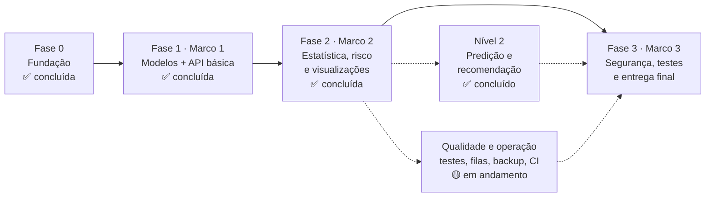

# Roadmap — SIMPA

Este documento organiza os próximos passos do SIMPA a partir do estado atual do repositório, do [SRS v1.0.0](docs/srs-v1.0.0.docx), das [decisões técnicas](docs/decisoes.md), do [DER](docs/der.md) e do [enunciado do Projeto Integrador](docs/enunciado-pi.pdf).

Cada fase corresponde a um **Marco** do enunciado. Cada tarefa indica os requisitos (RF/RNF) e as decisões (Dxx) que ela atende, o que já alimenta a matriz de rastreabilidade exigida pelo RNF13.

> **Como usar:** crie um *Milestone* no GitHub para cada Marco e transforme cada item com `[ ]` em uma *Issue* com a label do requisito (ex.: `RF07`). Marque `[x]` aqui quando o PR correspondente for aprovado.

---

## Visão geral

| Fase | Marco | Semanas (enunciado) | Foco | Status |
|---|---|---|---|---|
| 0 | — | 1–3 | Estrutura em serviços, Docker, SRS, DER, decisões | ✅ Concluída |
| 1 | Marco 1 | 4–7 | Models, migrações, CRUD, contrato da API | ✅ Concluída |
| 2 | Marco 2 | 8–13 | Indicadores, risco, gráficos, relatórios | ✅ Concluída, com Nível 2 |
| 3 | Marco 3 | 14–19 | Autenticação, RBAC, logs, testes, documentação final | 🟡 Em andamento: 3.1 a 3.4 prontos; falta a documentação e a entrega final (3.5) |
| Q | transversal | — | Entrega confiável de eventos, testes entre serviços e de navegador, monitoramento, backup e restauração, CI de integração, segurança de borda | 🟡 Em andamento: ver [Qualidade e operação](#qualidade-e-operação--entrega-confiável-testes-monitoramento-e-backup) |

---

## Fase 0 — Fundação ✅

O que já existe no repositório:

- [x] Arquitetura em serviços: `auth`, `academico` e `analitico`, cada um com o próprio banco — D13
- [x] Cada serviço organizado em camadas (`core`, `models`, `schemas`, `repositories`, `services`, `api`) — RNF01, RNF06
- [x] Docker Compose com gateway nginx, PostgreSQL, RabbitMQ, os três serviços, o worker do analítico e o frontend — D13, D16
- [x] `GET /health` e Swagger de cada serviço atrás do gateway (`/api/<serviço>/docs`)
- [x] Configuração por variáveis de ambiente com `pydantic-settings` — RNF04
- [x] Alembic por serviço, com a URL lida do ambiente e migrações aplicadas na subida
- [x] Tokens RS256 emitidos só pelo auth e validados pelos outros serviços via JWKS (`usuario_atual`) — D15
- [x] Eventos: publicador no acadêmico, worker consumidor no analítico e fila de falhas — D14
- [x] Logs JSON com `X-Request-ID` gerado no gateway e propagado nos eventos — RF12
- [x] Ruff com regras de segurança (`S`) e pytest em cada serviço — RNF02, RNF07
- [x] SRS v1.0.0, DER por serviço e registro de decisões D01–D21 — RNF05

---

## Ajustes rápidos antes da Fase 1

Pequenas correções encontradas na leitura do repositório. Vale resolver primeiro porque são rápidas e evitam confusão na banca.

- [ ] **Unificar o nome do projeto.** O README usa *Sistema Inteligente de Monitoramento e **Predição** Acadêmica* e o SRS usa *Sistema **Integrado** de Monitoramento e **Performance** Acadêmica*. Escolher um e corrigir no outro (o nome do enunciado é o do README).
- [x] **Separar as dependências.** Cada serviço tem o próprio `requirements.txt` só com o necessário para rodar; as ferramentas ficam no `requirements-dev.txt` da raiz.
- [ ] **Adicionar as dependências que ainda faltam, no serviço e na fase em que forem usadas:** nenhuma no momento. Já entraram `bcrypt` (auth), `httpx`, `numpy`, `openpyxl` e `reportlab` (analítico); os cálculos usam `Decimal` da biblioteca padrão, sem `pandas`.
- [x] **Criar o `main.py`** de cada serviço com a instância do FastAPI e a rota `GET /health`.
- [ ] **Preencher a tabela "Equipe"** do README com os 8 integrantes e suas responsabilidades. Sugestão: dividir o grupo por serviço (auth, acadêmico, analítico, frontend). *A seção foi removida do README; decidir se volta preenchida.*
- [x] **Configurar CI no GitHub Actions** (`.github/workflows/ci.yml`) rodando `ruff check .`, o `pytest` de cada serviço e `docker compose build` em todo push e PR. Isso prova o RNF02 e o RNF07 automaticamente.
- [ ] **Proteger a branch `main`**: merge só por PR com CI verde e ao menos 1 revisão. *Conferido em 2026-11-12: a `main` do grupo ainda aparece sem proteção. Os checks que devem ser obrigatórios: `CI` e `Integração e restauração`.*

---

## Fase 1 — Marco 1: Modelos e API básica ✅

**Objetivo do Marco 1 (enunciado):** arquitetura definida, modelagem documentada, classes implementadas e API básica funcional de cadastro e consulta.

### 1.1 Modelos e banco — RNF08, D01, D02, D13
- [x] Criar os models SQLAlchemy de cada serviço, conforme o DER:
  - `services/auth`: `Usuario`, `LogRequisicao`
  - `services/academico`: `Turma`, `Disciplina`, `Aluno`, `Inscricao`, `Avaliacao`, `Frequencia`
  - `services/analitico`: `ResultadoRisco`
- [x] Aplicar as restrições da tabela "Restrições que o banco deve garantir" do DER (`UNIQUE`, `CHECK`, `ON DELETE RESTRICT`)
- [x] IDs de outro serviço (`professor_id`, `inscricao_id` no analítico, `usuario_id` no log) **sem FK**, como no DER (D13)
- [x] Usar `Numeric(4, 2)` para `nota`, `peso` e `media_final`, e `Numeric(5, 2)` para `frequencia_final` (D06, D16: nada de `float`)
- [x] Importar todos os models no `app/models/__init__.py` de cada serviço (o Alembic depende disso)
- [x] Gerar e revisar a primeira migração de cada serviço: `docker compose exec <serviço> alembic revision --autogenerate -m "cria tabelas iniciais"`
- [x] Teste de integração: unicidade de matrícula e de `(aluno_id, disciplina_id)` e bloqueio de exclusão com histórico

### 1.2 Contrato da API e tratamento de erros — RF08, RF10, RNF02, RNF14
- [x] Schema genérico de resposta com `status`, `mensagem`, `dados`, `erro`, `pagina`, `limite`, `total_registros`
- [x] Exceções de domínio em `app/core/excecoes.py` de cada serviço (ex.: `RecursoNaoEncontrado`, `RegraDeNegocioViolada`, `DisciplinaEncerrada`), com o mesmo formato de resposta nos três
- [x] *Exception handlers* centralizados: validação → 400/422 com **campo, regra e código interno**; não encontrado → 404; erro inesperado → 500 **sem stack trace**
- [x] Catálogo de códigos internos de erro em `docs/codigos-erro.md`

### 1.3 Schemas (DTOs) — RF01, RF02, RF03, RF10
- [x] Schemas `Create`, `Update` e `Read` para cada entidade
- [x] Validador de CPF com dígitos verificadores
- [x] `frequencia_percentual` existe só no schema de saída (D02)
- [x] Validação `0 ≤ faltas ≤ aulas_previstas` e `aulas_previstas > 0`

### 1.4 Repositórios — RNF01
- [x] `BaseRepository` genérico (padrão *Repository*) com `obter`, `listar`, `criar`, `atualizar`, `inativar`
- [x] Paginação, ordenação e filtros em todas as listagens (RF08)
- [x] Nenhum outro módulo acessa a `Session` diretamente
- [x] Repositórios só fazem `add`/`flush`; o `commit()` fica no service, uma vez por caso de uso

### 1.5 Services e rotas CRUD (serviço acadêmico) — RF01, RF02, RF03, D10, D14
- [x] `turmas`, `disciplinas`, `alunos`, `inscricoes`, `avaliacoes`, `frequencias`
- [x] `DELETE` faz exclusão lógica (status inativo), conforme os princípios gerais
- [x] Bloquear criação, edição e exclusão de lançamentos em turma/disciplina `encerrada` (D10)
- [x] Encerrar uma turma bloqueia as disciplinas vinculadas (conferindo o status da turma, sem copiá-lo para as disciplinas)
- [x] Depois do commit, publicar `avaliacao.alterada`, `frequencia.alterada` ou `inscricao.alterada` com `app/events/publicador.py`
- [x] Rotas `/internal/inscricoes/{id}` (notas e frequências de uma inscrição) para o analítico consumir

### 1.6 Consulta integrada do aluno (serviço acadêmico) — RF04
- [x] `GET /alunos/{id}` e `GET /alunos/matricula/{matricula}` com cadastro, notas e frequências
- [x] Aluno inexistente → 404
- [x] Indicadores e risco entram na resposta (feito na Fase 2.3, vêm do analítico)

### 1.7 Dados sintéticos — RNF04, RNF08
- [x] Seed (`docker compose exec academico python -m app.comandos.seed`) gerando turmas, disciplinas, alunos, inscrições, notas e frequências **totalmente sintéticos**, pela API, e não direto nos bancos
- [x] Incluir casos de propósito: aluno com média baixa, aluno com frequência baixa, aluno na fronteira (6,00 / 75,00%) e aluno sem dados (D09)

### 1.8 Documentação do Marco 1 — RNF05
- [x] **Diagrama UML de casos de uso** em `docs/uml.md` (RNF05)
- [x] **Diagrama UML de classes** em `docs/uml.md` (RNF05)
- [x] Atualizar o README com o passo de seed
- [x] Roteiro de demonstração do Marco 1 em `docs/demonstracao-marco1.md`

**✔ Pronto quando:** `docker compose up` sobe tudo, o Swagger do acadêmico mostra os CRUDs, o seed popula o banco, a consulta do aluno funciona e o CI está verde.

---

## Fase 2 — Marco 2: Módulo analítico ✅

**Objetivo do Marco 2 (enunciado):** indicadores estatísticos, visualizações, integração dos cálculos à API e interpretação dos resultados.

Tudo nesta fase fica em `services/analitico`. Os dados vêm do acadêmico, pelas rotas `/internal`.

### 2.1 Serviço de estatística — RF05, D05, D06, D07
- [x] `app/services/estatistica.py` em funções puras (sem banco nem rede) com média simples, média ponderada, mediana, variância, desvio padrão, maior e menor nota, frequência média
- [x] Arredondamento com `Decimal` e `ROUND_HALF_UP` em 2 casas **antes** de qualquer comparação (D06)
- [x] Variância populacional × amostral conforme D07, retornando `tipo_variancia`; `null` + "amostra insuficiente" quando n < 2
- [x] Agregação por aluno, turma, disciplina e período letivo
- [x] Testes unitários com valores calculados à mão

### 2.2 Serviço de risco — RF07, RNF09, D04, D08, D09, D11
- [x] `app/services/regras.py` (funções puras) e `app/services/risco.py` (worker) calculando o risco **por inscrição**; o aluno fica Em Risco se qualquer inscrição ativa estiver Em Risco (D04)
- [x] Justificativa legível, citando disciplina, média e frequência (ex.: `"POO: média 4,50 (< 6,00) — media_baixa"`)
- [x] Sinal de **Atenção** quando Sem Risco com média 6,00–6,99 ou frequência 75,00–79,99% (D08)
- [x] Status **Indeterminado** para inscrição sem dados (D09)
- [x] Gravar novo `ResultadoRisco` só quando a classificação mudar (D11)
- [x] Testes obrigatórios: RF07 CA01, CA02, CA03 e as fronteiras 5,994 → Em Risco e 5,995 → Sem Risco

### 2.3 Integração com a API — RF03, RF04, RF05
- [x] Recalcular o risco sempre que uma avaliação ou frequência for criada, alterada ou excluída (worker do analítico; `python -m app.comandos.recalcular` refaz todas)
- [x] Rotas de indicadores no analítico: `/indicadores/alunos/{id}`, `/indicadores/turmas/{id}`, `/indicadores/disciplinas/{id}`, `/indicadores/periodos/{periodo}`
- [x] Rota de histórico de risco por inscrição (`/riscos/inscricoes/{id}/historico`) e painel consolidado (`/painel`, D20)
- [x] Consulta integrada do aluno (RF04) com indicadores, diagnóstico e histórico de risco, na gaveta do aluno na interface

### 2.4 Visualizações — RF06, RNF09, RNF12
- [x] **Decisão D12:** frontend em React + Vite + TypeScript, com identidade visual própria; telas Visão geral, Alunos, Análises e Relatórios (ver `frontend/README.md`)
- [x] Frontend ligado à API, com tela de login (a base de demonstração foi removida)
- [x] Gráficos: histograma de notas, dispersão (frequência × média), barras por disciplina e turma, evolução N1 → acumulado, ranking de disciplinas e anéis de situação
- [x] Todo gráfico com título, eixos, legenda e texto explicativo
- [x] Cores semânticas: coral = risco, amarelo = atenção, verde = sem risco, azul = informação (D12)
- [x] Status sempre escrito junto da cor ("Em Risco"), nunca só a cor (RNF12)

### 2.5 Relatórios — RF11
- [x] Filtros por período, turma, disciplina e status de risco
- [x] Exportação em CSV, XLSX (`openpyxl`) e PDF (`reportlab`)
- [x] Cabeçalho com data, hora e usuário que gerou
- [x] CPF e e-mail mascarados nos arquivos exportados (RNF04)

### 2.6 Nível 2 — Predição e recomendação ✅
- [x] **Decisão D21:** o SIMPA vai para o Nível 2
- [x] Correlação entre frequência e média (Pearson) por recorte, exibida no painel e nas análises como associação descritiva
- [x] Regressão linear múltipla (N2 a partir da N1 e da frequência da N1) com as equações normais em forma matricial (`numpy`), validação cruzada "deixa um de fora" e projeção do risco final (`GET /predicao`, tela de Análises)
- [x] Recomendações heurísticas a partir dos critérios violados, com prioridade, na gaveta do aluno
- [x] Interpretação automática: achados escritos na Visão geral e em Análises (padrões, origem do risco, tendência N1 → acumulado)
- [x] Limites do modelo explicados na tela e na D21
- [ ] `notebooks/` com a exploração estatística que justifica as escolhas (opcional)

**✔ Pronto quando:** os indicadores e o risco aparecem pela API, os gráficos refletem o banco, os relatórios exportam nos 3 formatos e os testes de RF05 e RF07 passam.

---

## Fase 3 — Marco 3: Segurança, robustez e entrega final

**Objetivo do Marco 3 (enunciado):** API com autenticação e controle de acesso, segurança básica, logs, testes, documentação e relatório final.

> 💡 O enunciado deixa autenticação para a semana 14, mas a dependência `usuario_atual` já existe no acadêmico e no analítico. Usar nas rotas desde a Fase 1 evita reescrevê-las depois.

### 3.1 Autenticação e RBAC — RF09, D03, D15
- [x] Emissão de JWT RS256 com `sub`, `role` e expiração (`criar_token` no auth) e validação via JWKS nos outros serviços
- [x] Hash de senha com bcrypt (Restrição 1)
- [x] `POST /login` no auth (pelo gateway: `/api/auth/login`) usando `criar_token`
- [x] Login inválido → 401 com mensagem genérica, sem dizer se foi o e-mail ou a senha (RF09 CA01)
- [x] Rota protegida sem token → 401 (todas as rotas do acadêmico exigem token, D17)
- [x] Dependências de autorização seguindo a tabela da D03 (`exigir_roles`; "gerenciar usuários" ainda não tem rota no auth)
- [x] Professor só lança e consulta dados das próprias disciplinas (acadêmico e analítico)
- [x] Só Admin reabre turma/disciplina encerrada (D10)
- [x] Um usuário de cada perfil para a demonstração (`USUARIOS_DEMO`)

### 3.2 Logs e auditoria — RF12, RNF16
- [x] **Correlation ID** gerado no gateway, devolvido no cabeçalho de resposta e propagado nos eventos
- [x] Logs em JSON estruturado em todos os serviços
- [x] Gravação em `LogRequisicao` (banco do auth) com `usuario_id`, rota, método, status, IP e tempo de resposta. Os serviços publicam o evento `log.requisicao` e o `auth-worker` grava (ver decisoes.md, seção de comunicação)
- [x] Nunca registrar senha, token ou CPF completo; testes automatizados em `tests/test_auditoria.py` de cada serviço

### 3.3 Segurança de entrada — RNF15, RNF04
- [x] Testes de SQL Injection (o ORM protege, mas o teste comprova): `tests/test_seguranca_entradas.py` de cada serviço
- [x] Sanitização contra XSS em campos de texto: `<`, `>` e caracteres de controle são recusados (`core/entradas.py`)
- [x] Proteção contra *Parameter Pollution*: parâmetro de query repetido responde 400 `PARAMETRO_REPETIDO`
- [ ] CORS: com o front e as APIs atrás do mesmo gateway, não é preciso liberar outras origens; manter assim
- [x] Cabeçalhos de segurança no gateway (`X-Content-Type-Options`, `X-Frame-Options`, `Referrer-Policy`, `Permissions-Policy`) e `Content-Security-Policy` da página (`script-src 'self'`, sem `unsafe-eval`), com teste de integração e teste de navegador que percorre as telas e falha se algo for bloqueado
- [x] Revisar se algum painel expõe CPF ou e-mail sem necessidade: CPF só sai mascarado; o analítico só leva e-mail mascarado nos relatórios (testado)

### 3.4 Qualidade e desempenho — RNF03, RNF07, RNF10
- [x] Documentar no OpenAPI as respostas de cada rota: 400, 401, 403, 404, 422 e 500 no envelope `ErroPadrao` (`core/openapi.py`)
- [x] Medir cobertura com `pytest-cov` (auth 90%, acadêmico 87%, analítico 95%); o CI exige 80% por serviço
- [x] Testes de contrato das principais rotas: `tests/test_contrato.py` de cada serviço
- [x] Índices revisados contra as consultas reais (compostos filtro + ordenação, redundantes removidos); migrações conferidas contra os models por teste
- [x] Medir no PostgreSQL com volume se as listagens paginadas ficam abaixo de 300 ms: ficam (10–25 ms com 3 mil alunos). As rotas agregadas do analítico levam ~3 s com 9 mil inscrições (D20); ver `docs/desempenho.md`
- [x] CI de integração (`.github/workflows/integracao.yml`): sobe o ambiente completo e roda os testes entre serviços, os de navegador e a prova de restauração
- [ ] Decidir se as rotas agregadas do analítico (`painel`, `alertas`, `predicao`, `cenarios`, `relatorios`, ~3 s com 9 mil inscrições) serão otimizadas agora (D20)
- [ ] Refatoração final guiada pelo ruff e pela revisão em grupo

### 3.5 Documentação e apresentação — RNF05, RNF13
- [x] `docs/rastreabilidade.md`: matriz ligando cada RF/RNF a models, services, rotas e testes
- [ ] Revisar UML de casos de uso, UML de classes e DER para refletir o código final
- [ ] Atualizar `decisoes.md` com as decisões tomadas nas Fases 1–3 *(a D14, entrega confiável por outbox, já está atualizada)*
- [ ] Relatório técnico final: arquitetura, justificativa das análises, exemplos de indicadores e reflexão sobre o processo
- [ ] README final com passo a passo completo e prints
- [ ] Roteiro do pitch e ensaio cronometrado da demonstração
- [ ] Lista de melhorias futuras (ex.: deploy em nuvem, HTTPS no gateway, token de vida curta com renovação e revogação; o *outbox* dos eventos já foi feito, D14)

**✔ Pronto quando:** todos os critérios de aceitação do SRS passam, o CI está verde, a matriz de rastreabilidade está completa e a demonstração roda do zero seguindo só o README.

---

## Qualidade e operação — entrega confiável, testes, monitoramento e backup

Trabalho transversal às fases 2 e 3, feito a partir do plano de qualidade e operação. O registro completo, com resultados e números, está em [docs/evidencias-qualidade-operacao.md](docs/evidencias-qualidade-operacao.md); a operação das filas está em [docs/operacao-filas.md](docs/operacao-filas.md).

### Q.1 Ambiente isolado e testes entre serviços — RNF07
- [x] `compose.test.yml`: projeto `simpa-test` próprio, só o gateway publica porta (`127.0.0.1:18080`), credenciais sintéticas, nada compartilhado com o ambiente de desenvolvimento
- [x] `tests/integration`: testes entre serviços com HTTP e RabbitMQ reais (fluxo principal, permissões, worker e broker interrompidos, despachantes concorrentes, monitoramento, cabeçalhos de segurança e listagem de usuários)
- [x] Correção de segurança (D03): a consulta integrada do aluno devolvia notas e frequências de outro professor; agora filtra pelo escopo do usuário, com teste de regressão

### Q.2 Entrega confiável dos eventos — D14
- [x] **Outbox** no acadêmico: o evento é gravado na mesma transação da alteração (`evento_outbox`); o container `academico-despachante` publica com confirmação do broker. **Sem ele nenhum evento sai**
- [x] Worker do analítico idempotente por `event_id` (`evento_processado`), com novas tentativas (5 s, 30 s, 2 min) e fila de falhas com o motivo; comando `python -m app.comandos.reprocessar_falhas`
- [x] Workers e despachante reconectam quando o RabbitMQ cai (antes morriam com `socket.gaierror`)
- [ ] Em ambiente com dados: a exchange legada `simpa.eventos.falhas` exige esvaziar e recriar a fila principal (passo documentado)

### Q.3 Testes de navegador e contrato — RNF11, RNF12
- [x] Playwright (versão fixa) contra o ambiente isolado: login, cadastros, lançamentos, escopo do professor, usabilidade e segurança (CSP)
- [x] Contrato front × backend: os 17 valores enumerados do front são os do backend (`tests/contrato`, roda no CI)
- [ ] Auditoria automatizada de contraste e conferência sistemática dos campos obrigatórios

### Q.4 Telas de gestão — RF01, RF02, RF03
- [x] **Cadastros** (admin e coordenação): turmas, disciplinas, alunos e inscrições, com busca, filtro, paginação, edição e inativação
- [x] **Lançamentos** (admin e professor): planilha por disciplina com nota e faltas de N1 e N2; filtro `disciplina_id` nas listagens
- [x] `GET /auth/usuarios` (admin e coordenador, sem e-mail): o professor responsável é escolhido por nome
- [x] Filtro global de turmas busca todas as páginas e avisa se algo ficar de fora

### Q.5 Monitoramento das filas
- [x] Prometheus, Alertmanager e Grafana em camada separada (`compose.monitoramento.yml`), em versões fixas e só em `127.0.0.1`
- [x] 12 regras de alerta com 15 casos de teste (`promtool`) e simulação real: worker parado, evento inválido e broker parado
- [ ] Ajustar os limites dos alertas com carga real (os atuais são os iniciais do plano)
- [ ] Definir o canal real dos alertas (e-mail ou chat): hoje vão só a um receptor local de teste

### Q.6 Backup e restauração
- [x] Decisão de RPO e RTO: backup diário, RPO de cerca de 24 h
- [x] Backup cifrado (AES-256-GCM) dos três bancos e das chaves de assinatura, com janela controlada para consistência (`scripts/backup/`)
- [x] Restauração só em ambiente descartável e vazio; recusa pacote adulterado, chave errada, banco não vazio e versão de migração diferente
- [x] Prova ponta a ponta em `compose.restore-test.yml`: chaves, usuários, dados e histórico idênticos; o worker processa uma mudança nova; RTO medido em 30 s numa base pequena
- [ ] **Agendamento** do backup (hoje só existe se alguém o rodar)
- [ ] **Retenção** (7 cópias diárias e 4 semanais) e **cópia externa**, com decisão de onde guardar a chave
- [ ] Simulação de falha do backup (disco cheio, container parado no meio)
- [ ] Repetir a medição do RTO com volume real de dados

### Q.7 CI de integração
- [x] `ci.yml` rápido: lint, testes dos serviços, contrato, backup, monitoramento e build do front
- [x] `integracao.yml`: ambiente completo, testes entre serviços, de navegador e prova de restauração, em pull request, na `main`, toda segunda-feira e sob demanda (cerca de 15 a 20 min)
- [x] Instalação do navegador do Playwright resistente a falha de rede do runner (CDN do Playwright, com tentativas)

### Q.8 Segurança de borda
- [x] Cabeçalhos HTTP e CSP (ver 3.3)
- [ ] HTTPS e HSTS: ficam no proxy TLS de produção, na frente do gateway
- [ ] Token de vida curta com renovação (hoje 60 min) e revogação antes de expirar

**✔ Pronto quando:** o backup roda sozinho com retenção e cópia externa, a restauração foi repetida com volume real, os alertas têm limites ajustados e um canal real, e o `integracao.yml` está como check obrigatório na `main`.

---

## Riscos e dependências

| Risco | Impacto | Como reduzir |
|---|---|---|
| Erro de arredondamento na fronteira 6,00 / 75,00% | Classificação de risco errada na banca | `Decimal` em todo o fluxo + testes de fronteira (D06) |
| RBAC adicionado só no fim | Reescrita de várias rotas | Dependência `usuario_atual` desde a Fase 1 |
| Trabalho concentrado em poucas pessoas | Atrasos e domínio desigual na arguição | Issues com responsável e revisão cruzada em PR |
| Dados reais no ambiente de desenvolvimento | Violação da LGPD (RNF04) | Usar só o seed sintético |
| Contratos entre serviços mudarem sem aviso | Um serviço quebra o outro | Documentar as rotas `/internal` e os eventos; testes de contrato; mudanças em PR revisado pelos dois lados |
| Broker fora do ar perde eventos | Nota salva, mas o risco não é recalculado | Outbox + despachante + fila de falhas; alertas de monitoramento (Q.2, Q.5) |
| Backup que só existe se alguém lembrar de rodar | RPO de 24 h só no papel | Agendar o backup e testar a restauração toda semana (Q.6, Q.7) |
| Rede do runner do CI instável (DNS dos mirrors do Ubuntu) | Falha do job sem falha de código | Navegador do Playwright pelo CDN, com tentativas; `ci.yml` rápido separado do `integracao.yml` |
| Docker pesado em máquinas mais fracas | Integrante sem conseguir rodar o projeto | Testar cedo em todas as máquinas; `docker compose up <serviço>` sobe só o necessário |

---

## Convenções de trabalho

- **Branches:** `feat/...`, `fix/...`, `docs/...`, `chore/...`, `test/...`
- **Commits:** padrão já usado no repositório (`feat:`, `fix:`, `docs:`, `chore:`, `test:`)
- **PRs:** citar o requisito no título ou na descrição (ex.: `feat(risco): classificação por inscrição — RF07, D04`)
- **Definição de pronto de uma tarefa:** código + teste + ruff limpo + CI verde + revisão de outro integrante
