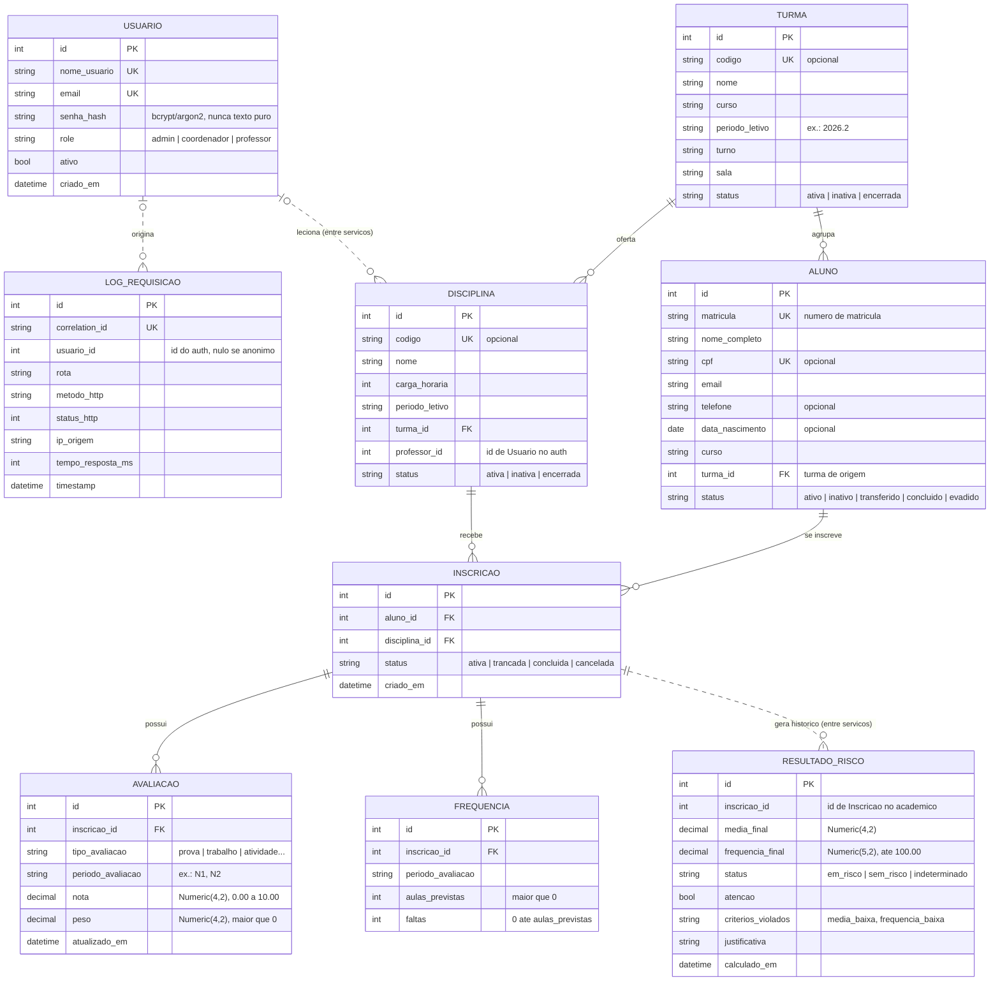

# DER — Diagrama Entidade-Relacionamento do SIMPA

Baseado no SRS v1.0.0 e nas decisões registradas em [`decisoes.md`](decisoes.md).

Cada serviço tem o próprio banco (D13). As linhas **contínuas** são FKs reais, dentro do mesmo banco. As linhas **pontilhadas** ligam bancos diferentes: o campo guarda o id, mas o banco não garante a integridade, e quem confere é a aplicação.

| Banco | Serviço | Tabelas |
|---|---|---|
| `auth_db` | auth | `USUARIO`, `LOG_REQUISICAO` |
| `academico_db` | acadêmico | `TURMA`, `DISCIPLINA`, `ALUNO`, `INSCRICAO`, `AVALIACAO`, `FREQUENCIA` |
| `analitico_db` | analítico | `RESULTADO_RISCO` |

## Como ler as cardinalidades

| Símbolo | Significado |
|---|---|
| `\|\|` | exatamente um (obrigatório) |
| `\|o` | zero ou um (opcional) |
| `o{` | zero ou muitos |
| `--` | FK real, dentro do mesmo banco |
| `..` | referência por id, entre bancos de serviços diferentes |

Exemplo: `TURMA ||--o{ ALUNO` significa que todo aluno pertence a exatamente uma turma e que uma turma tem zero ou mais alunos.

## Restrições que o banco deve garantir (RNF08)

| Banco | Tabela | Restrição | Origem |
|---|---|---|---|
| acadêmico | aluno | `UNIQUE(matricula)`, `UNIQUE(cpf)` (permite nulo) | RF01 |
| acadêmico | turma, disciplina | `UNIQUE(codigo)` (permite nulo) | RF02 |
| auth | usuario | `UNIQUE(email)`, `UNIQUE(nome_usuario)` | RF09 |
| acadêmico | inscricao | `UNIQUE(aluno_id, disciplina_id)` | D01 |
| acadêmico | avaliacao | `CHECK(nota BETWEEN 0 AND 10)`, `CHECK(peso > 0)` | RF03 |
| acadêmico | frequencia | `CHECK(aulas_previstas > 0)`, `CHECK(faltas BETWEEN 0 AND aulas_previstas)`, `UNIQUE(inscricao_id, periodo_avaliacao)` | RF03, D02 |
| acadêmico | registro_semanal | `UNIQUE(inscricao_id, semana_inicio)`, `CHECK(atividades_entregues BETWEEN 0 AND atividades_previstas)` | RF07 |
| analítico | resultado_risco | índice em `inscricao_id` (consulta do histórico) | D11 |
| analítico | atendimento_alerta | `UNIQUE(aluno_id, tipo, disciplina_id)`, `CHECK` em tipo, estado e nível | RF07 |
| analítico | acompanhamento | índice em `aluno_id`, `CHECK` em tipo | RF07 |
| todos | FKs dentro do mesmo banco | `ON DELETE RESTRICT` (sem exclusão física com histórico) | Restrição 3 |

## O que fica de fora do banco (e por quê)

- **Indicadores estatísticos (RF05):** são calculados sob demanda no serviço analítico. Guardá-los criaria dados duplicados que podem ficar desatualizados.
- **`frequencia_percentual`:** é derivado de `faltas` e `aulas_previstas` (D02).
- **`ResultadoRisco`** é a exceção. Ele é persistido porque o RF07 exige registrar o critério violado, e o histórico permite ver a evolução do aluno. Uma linha nova só é gravada quando a classificação muda (D11).
- **`AtendimentoAlerta`** e **`Acompanhamento`** também são persistidos, porque registram decisões humanas (situação do atendimento e ações da coordenação). Os **alertas em si continuam derivados**: são calculados na hora, nos sinais `queda`, `frequencia` e `abandono`. O atendimento guarda o nível do alerta no momento da decisão; se o alerta piorar depois, ele volta a aparecer como pendente. O `abandono` é um alerta do aluno (disciplina 0) e usa o `RegistroSemanal` do acadêmico: presença e atividades por semana, identificada pela segunda-feira.

## Regras que o banco NÃO garante sozinho (ficam no service)

- Não lançar nota ou frequência em uma disciplina ou turma `encerrada` (D10). Conferir o status da disciplina **e** o da turma dela, em vez de copiar o status da turma para cada disciplina.
- Só o professor da disciplina pode lançar notas nela (D03): o `sub` do token precisa ser igual a `Disciplina.professor_id`.
- Ao cadastrar uma disciplina, conferir no auth se o `professor_id` existe e tem role `professor` (D13).
- Publicar um evento a cada alteração de avaliação, frequência ou inscrição; o analítico recalcula o risco e grava um novo `ResultadoRisco` só quando a classificação mudar (RF03, D11, D14).
- Validar a sintaxe do CPF (dígitos verificadores) (RF01).
