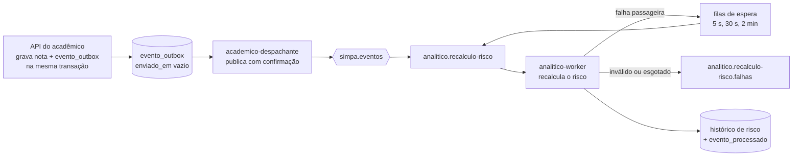

# Operação das filas de eventos

Como os eventos andam, como saber que algo parou e como recuperar. Complementa a [D14](decisoes.md). Os comandos de exemplo usam o ambiente de teste (`compose.test.yml`, projeto `simpa-test`); em desenvolvimento, troque pelo `docker compose` normal.

## O caminho de um evento



| Onde pode parar | Como aparece | O que acontece sozinho |
|---|---|---|
| Broker fora do ar | linhas em `evento_outbox` com `enviado_em` vazio | o despachante reconecta e envia; nada se perde |
| Fila sem consumidor (worker parado) | mensagens acumulando em `analitico.recalculo-risco` | ao voltar, o worker drena a fila |
| Evento sem fila ligada | `evento_outbox.tentativas` > 0 e `ultimo_erro` com `UnroutableError` | nova tentativa com espera crescente |
| Acadêmico fora do ar para o worker | mensagem nas filas `…espera.Ns` | volta à fila principal depois da espera |
| Evento inválido ou 3 tentativas esgotadas | mensagem em `analitico.recalculo-risco.falhas` | nada: exige ação humana (abaixo) |

## Localizar um evento

Eventos que ainda não saíram do acadêmico:

```bash
docker compose --env-file .env.test -p simpa-test -f compose.test.yml exec postgres \
  sh -c 'psql -U "$POSTGRES_USER" -d academico_db -c "SELECT id, chave, tentativas, ultimo_erro, criado_em FROM evento_outbox WHERE enviado_em IS NULL ORDER BY criado_em"'
```

Estado das filas (mensagens e consumidores):

```bash
docker compose --env-file .env.test -p simpa-test -f compose.test.yml exec rabbitmq \
  rabbitmqctl list_queues name messages consumers
```

Para seguir um evento pelos logs, procure o `event_id` (ou o `request_id` da requisição que o originou) nos logs do despachante e do worker.

## Fila de falhas: examinar, corrigir, reprocessar

1. **Listar** sem consumir nada. Mostra `event_id`, a chave, as tentativas e o motivo (`x-erro`):

   ```bash
   docker compose --env-file .env.test -p simpa-test -f compose.test.yml exec analitico \
     python -m app.comandos.reprocessar_falhas --listar
   ```

2. **Descobrir a causa.** O motivo e os logs do worker dizem se o evento é inválido (um problema de quem o gerou) ou se o serviço de que ele dependia estava fora do ar.
3. **Corrigir a causa** antes de reprocessar. Um evento inválido reprocessado sem correção volta para a fila de falhas.
4. **Reprocessar.** Devolve cada mensagem à fila principal **uma vez** por execução, sem loop. Use `--limite N` para um lote pequeno primeiro:

   ```bash
   docker compose --env-file .env.test -p simpa-test -f compose.test.yml exec analitico \
     python -m app.comandos.reprocessar_falhas --limite 10
   ```

5. **Confirmar.** A fila de falhas esvazia e o histórico da inscrição (`GET /analitico/riscos/inscricoes/{id}/historico`) mostra a situação atualizada.

Reprocessar é seguro: o worker ignora um `event_id` que já tratou, e o recálculo do risco parte do estado atual da inscrição. Reprocessar o mesmo evento duas vezes não cria transição duplicada. O comando recalcula o estado **atual**; ele não reconstrói transições históricas que nunca foram registradas.

## O que não fazer

- Não esvaziar uma fila (`purge_queue`) fora de um ambiente de teste: as mensagens descartadas são eventos de negócio.
- Não reenviar à mão uma mensagem inválida em laço. O comando de reprocessamento devolve cada mensagem uma só vez.
- Não confundir "container no ar" com "worker pronto": no ambiente de teste a prontidão exige a fila declarada e com consumidor (`healthcheck` do `compose.test.yml`).


## Monitoramento

Camada separada (`compose.monitoramento.yml`, configuração em `infra/monitoramento/`) com Prometheus, Alertmanager, Grafana e um receptor **local** de teste. Somada ao ambiente de teste:

```bash
docker compose --env-file .env.test -p simpa-test -f compose.test.yml -f compose.monitoramento.yml up -d --wait
```

| O quê | Endereço (só `127.0.0.1`) | Observação |
|---|---|---|
| Grafana | http://127.0.0.1:13000 (usuário `admin`, senha `GRAFANA_SENHA` do `.env.test`) | dashboard **SIMPA — Filas de eventos**, na pasta SIMPA; acesso anônimo desligado |
| Prometheus | http://127.0.0.1:19090 | regras e alertas em `/alerts` |
| Alertmanager | http://127.0.0.1:19093 | alertas inibidos e silêncios |

As métricas do RabbitMQ (`rabbitmq:15692`), do despachante e do worker (`:9100`) ficam **só na rede interna** do Compose. Nada aqui é publicado na internet. Versões fixas: Prometheus `v2.55.1`, Alertmanager `v0.27.0`, Grafana `11.3.1`. Retenção do Prometheus: 15 dias ou 2 GB (o que vier primeiro), em volume próprio, assim como o Alertmanager e o Grafana.

### Métricas

Os nomes do RabbitMQ foram **conferidos no RabbitMQ 4.4.0 real**, não supostos. As por fila vêm de `/metrics/detailed?family=queue_coarse_metrics&family=queue_consumer_count`.

| Métrica | Origem | Para que serve |
|---|---|---|
| `rabbitmq_detailed_queue_messages_ready{queue}` | RabbitMQ | acúmulo por fila |
| `rabbitmq_detailed_queue_messages_unacked{queue}` | RabbitMQ | entregues e ainda em processamento |
| `rabbitmq_detailed_queue_consumers{queue}` | RabbitMQ | worker ausente |
| `rabbitmq_global_messages_received_total`, `…_delivered_total`, `…_acknowledged_total` | RabbitMQ | taxas de publicação, entrega e confirmação |
| `rabbitmq_global_messages_unroutable_returned_total` | RabbitMQ | mensagens sem destino devolvidas |
| `academico_outbox_eventos_pendentes` | despachante | quantos eventos ainda não saíram |
| `academico_outbox_idade_evento_mais_antigo_segundos` | despachante | atraso **antes** do broker |
| `academico_despachante_publicacoes_total{resultado}` | despachante | `ok`, `sem_destino`, `recusado` |
| `academico_despachante_reconexoes_total{motivo}` | despachante | `broker` ou `banco` |
| `academico_despachante_ultimo_ciclo_timestamp_segundos` | despachante | detecta o laço parado |
| `analitico_eventos_total{resultado}` | worker | `ok`, `repetido`, `invalido`, `retentativa`, `falha` |
| `analitico_evento_latencia_segundos` (histograma) | worker | da alteração no acadêmico ao fim do processamento |
| `analitico_evento_processamento_segundos` (histograma) | worker | só o recálculo |
| `analitico_consumidor_reconexoes_total` | worker | instabilidade do broker |

A latência de ponta a ponta usa o `ocorrido_em` que vai no envelope do evento: ela **não pode ser deduzida do tamanho da fila**. Nenhum rótulo leva nome, e-mail, token ou id de aluno/inscrição.

### Alertas

Os limites são **iniciais**, a ajustar depois de observar carga real. Cada alerta tem teste em `infra/monitoramento/prometheus/regras.test.yml`, que prova nos dois sentidos: dispara quando deve e fica quieto quando não deve.

| Alerta | Condição | Gravidade |
|---|---|---|
| `FilaSemConsumidor` | fila esperada sem consumidor por mais de 1 minuto | crítico |
| `FilaEsperadaAusente` | a série da fila esperada sumiu das métricas por mais de 1 minuto | crítico |
| `FilaDeFalhasRecebeuMensagens` | cresceu o número de mensagens de uma fila de falhas nos últimos 5 minutos | crítico |
| `FilaDeFalhasNaoVazia` | fila de falhas com mensagens há mais de 30 minutos | aviso |
| `EventoPendenteNaOutbox` | evento mais antigo da outbox com mais de 2 minutos | crítico |
| `FilaCrescendo` | fila principal crescendo mais de 3 mensagens por minuto por 5 minutos, com mais de 20 prontas | aviso |
| `EventoSemDestino` | despachante com publicações `sem_destino` ou `recusado` nos últimos 5 minutos | aviso |
| `ProcessamentoLento` | p95 da latência de ponta a ponta acima de 60 s por 5 minutos | aviso |
| `ReconexoesFrequentes` | mais de 3 reconexões em 10 minutos | aviso |
| `DespachanteParado` | despachante sem completar um ciclo há mais de 1 minuto | crítico |
| `ColetaDeMetricasAusente` | alvo de coleta fora do ar por mais de 1 minuto | crítico |
| `AlvoDeColetaSumiu` | nem a série `up` de um alvo existe | crítico |

**Fila ausente não é fila saudável.** `FilaEsperadaAusente` e `AlvoDeColetaSumiu` existem porque, sem a série, os outros alertas calariam. No painel, "sem dado" aparece em vermelho.

**Menos ruído:** todo alerta tem um `for:` que absorve a inicialização e as oscilações. No Alertmanager, `FilaSemConsumidor` inibe `FilaCrescendo` da mesma fila (a fila cresce por consequência), e a falta de coleta do RabbitMQ inibe `FilaEsperadaAusente` (a fila "sumiu" por consequência). Para uma manutenção planejada, crie um silêncio:

```bash
docker compose --env-file .env.test -p simpa-test -f compose.test.yml -f compose.monitoramento.yml exec alertmanager \
  amtool --alertmanager.url=http://localhost:9093 silence add 'alertname=~".+"' --duration=30m --comment="manutenção do broker"
```

### O que fazer em cada alerta

#### Alerta FilaSemConsumidor
O worker não está ligado à fila. Veja `docker compose ps` e os logs do `analitico-worker` (ou `auth-worker`). Religue (`up -d analitico-worker`). Os eventos acumulados são processados quando ele volta; nada se perde.

#### Alerta FilaEsperadaAusente
A fila não existe ou o RabbitMQ não a informa. Confira `rabbitmqctl list_queues`. A fila é declarada pelo worker ao iniciar: se ela sumiu, reinicie o worker. Se o RabbitMQ está fora da coleta, este alerta fica inibido e o `ColetaDeMetricasAusente` é a causa.

#### Alerta FilaDeFalhasRecebeuMensagens
Um evento foi recusado ou esgotou as tentativas. Siga a seção "Fila de falhas: examinar, corrigir, reprocessar": listar, descobrir a causa (cabeçalho `x-erro`), corrigir e reprocessar. Falhas do auth e do analítico ficam em filas separadas.

#### Alerta FilaDeFalhasNaoVazia
Há mensagens esquecidas na fila de falhas. Decida: reprocessar (depois de corrigir a causa) ou descartar de forma consciente. Não ignore.

#### Alerta EventoPendenteNaOutbox
O acadêmico gravou, mas o evento não saiu. Causas comuns: RabbitMQ fora do ar, fila sem ligação à exchange, despachante parado. Veja `evento_outbox.ultimo_erro` (consulta na seção "Localizar um evento") e os logs do `academico-despachante`. Os eventos saem sozinhos quando o destino voltar.

#### Alerta FilaCrescendo
A entrada é maior que a vazão. Compare no Grafana as taxas publicadas, entregues e confirmadas, e o tempo de processamento. Se o acadêmico (consultado pelo worker) está lento, o tempo de processamento sobe junto.

#### Alerta EventoSemDestino
O broker não aceitou a mensagem: tipicamente falta uma fila ligada à exchange `simpa.eventos`. O evento fica na outbox e é tentado de novo com espera crescente. Reinicie o worker para redeclarar a topologia.

#### Alerta ProcessamentoLento
A atualização do risco está atrasada. Veja o p50 e o p95 no Grafana e o tempo de processamento de um evento. Confira se há acúmulo na fila e se o acadêmico responde rápido.

#### Alerta ReconexoesFrequentes
O RabbitMQ (ou o banco) está instável para o despachante ou para o worker. Veja os logs de reconexão e a saúde do RabbitMQ.

#### Alerta DespachanteParado
O despachante não completa um ciclo. Pode estar travado ou preso tentando reconectar (com o broker fora do ar ele também dispara). Veja os logs e reinicie se travou. Os eventos esperam na outbox.

#### Alerta ColetaDeMetricasAusente
Um alvo não responde à coleta (`Status > Targets` no Prometheus). Sem métricas dele, os outros alertas ficam cegos para o que ele informaria. Veja se o contêiner está de pé e se o endpoint de métricas responde.

### Simulação e provas

- **Regras (rápido, sem ambiente):** `promtool test rules` em `infra/monitoramento/prometheus/regras.test.yml` (15 casos, incluindo os alertas lentos e o silêncio quando está tudo normal), mais `promtool check` da configuração e `amtool check-config`.
- **Simulação real:** `tests/integration/test_monitoramento.py` (leva cerca de 6 a 7 minutos). Para o worker e vê `FilaSemConsumidor` disparar e voltar ao normal; manda um evento inválido e vê a fila de falhas; derruba o broker e vê o atraso na outbox, a coleta do RabbitMQ e a inibição de `FilaEsperadaAusente`. Em todos, a notificação chega ao receptor **local** de teste e a normalização também. Nada é enviado a pessoas nem a canais externos.
- **Receptor de teste:** `docker compose … exec receptor-alertas` guarda o que recebeu (`GET /alertas`). Para um destino real (e-mail, chat), troque o receptor em `alertmanager.yml` só depois de autorizado.
