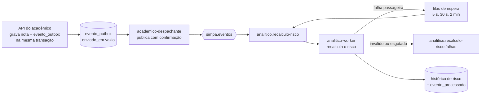

# Operação das filas de eventos

Como os eventos andam, como saber que algo parou e como recuperar. Complementa a [D14](decisoes.md). Os comandos de exemplo usam o ambiente de teste (`compose.test.yml`, projeto `simpa-test`); em desenvolvimento, troque pelo `docker compose` normal.

## O caminho de um evento



| Onde pode parar | Como aparece | O que acontece sozinho |
|---|---|---|
| Broker fora do ar | linhas em `evento_outbox` com `enviado_em` vazio | o despachante reconecta e envia; nada se perde |
| Fila sem consumidor (worker parado) | mensagens acumulando em `analitico.recalculo-risco` | ao voltar, o worker drena a fila |
| Evento sem fila ligada | `evento_outbox.tentativas` > 0 e `ultimo_erro` com `UnroutableError` | nova tentativa com espera crescente |
| Acadêmico fora do ar para o worker | mensagem nas filas `…espera.Ns` | volta à fila principal depois da espera |
| Evento inválido ou 3 tentativas esgotadas | mensagem em `analitico.recalculo-risco.falhas` | nada: exige ação humana (abaixo) |

## Localizar um evento

Eventos que ainda não saíram do acadêmico:

```bash
docker compose --env-file .env.test -p simpa-test -f compose.test.yml exec postgres \
  sh -c 'psql -U "$POSTGRES_USER" -d academico_db -c "SELECT id, chave, tentativas, ultimo_erro, criado_em FROM evento_outbox WHERE enviado_em IS NULL ORDER BY criado_em"'
```

Estado das filas (mensagens e consumidores):

```bash
docker compose --env-file .env.test -p simpa-test -f compose.test.yml exec rabbitmq \
  rabbitmqctl list_queues name messages consumers
```

Para seguir um evento pelos logs, procure o `event_id` (ou o `request_id` da requisição que o originou) nos logs do despachante e do worker.

## Fila de falhas: examinar, corrigir, reprocessar

1. **Listar** sem consumir nada. Mostra `event_id`, a chave, as tentativas e o motivo (`x-erro`):

   ```bash
   docker compose --env-file .env.test -p simpa-test -f compose.test.yml exec analitico \
     python -m app.comandos.reprocessar_falhas --listar
   ```

2. **Descobrir a causa.** O motivo e os logs do worker dizem se o evento é inválido (um problema de quem o gerou) ou se o serviço de que ele dependia estava fora do ar.
3. **Corrigir a causa** antes de reprocessar. Um evento inválido reprocessado sem correção volta para a fila de falhas.
4. **Reprocessar.** Devolve cada mensagem à fila principal **uma vez** por execução, sem loop. Use `--limite N` para um lote pequeno primeiro:

   ```bash
   docker compose --env-file .env.test -p simpa-test -f compose.test.yml exec analitico \
     python -m app.comandos.reprocessar_falhas --limite 10
   ```

5. **Confirmar.** A fila de falhas esvazia e o histórico da inscrição (`GET /analitico/riscos/inscricoes/{id}/historico`) mostra a situação atualizada.

Reprocessar é seguro: o worker ignora um `event_id` que já tratou, e o recálculo do risco parte do estado atual da inscrição. Reprocessar o mesmo evento duas vezes não cria transição duplicada. O comando recalcula o estado **atual**; ele não reconstrói transições históricas que nunca foram registradas.

## O que não fazer

- Não esvaziar uma fila (`purge_queue`) fora de um ambiente de teste: as mensagens descartadas são eventos de negócio.
- Não reenviar à mão uma mensagem inválida em laço. O comando de reprocessamento devolve cada mensagem uma só vez.
- Não confundir "container no ar" com "worker pronto": no ambiente de teste a prontidão exige a fila declarada e com consumidor (`healthcheck` do `compose.test.yml`).
