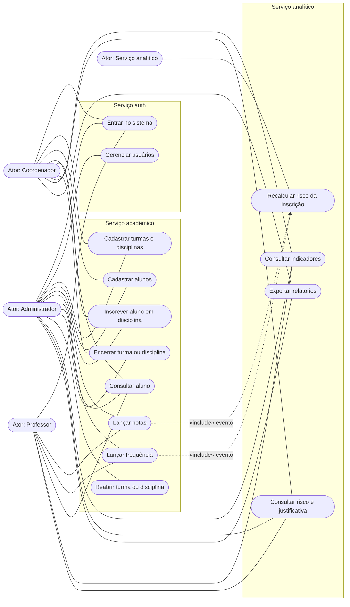
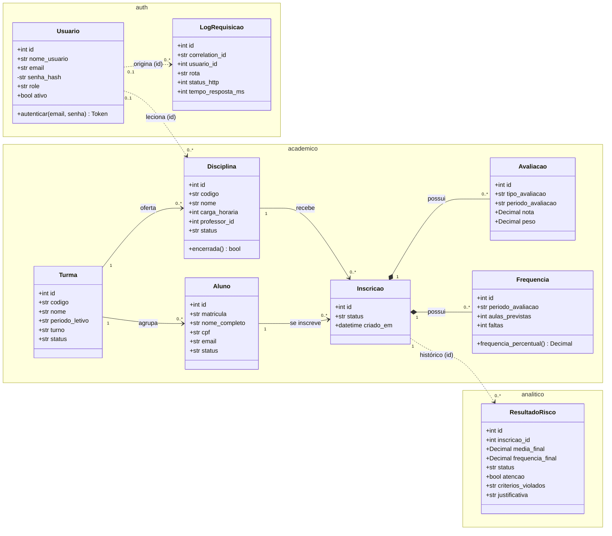
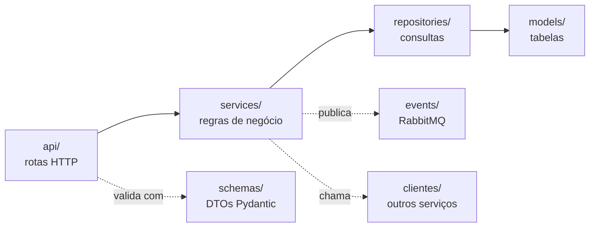

# Diagramas UML do SIMPA

Diagramas exigidos pelo RNF05. Estão em [Mermaid](https://mermaid.js.org/), que o GitHub desenha direto na página; para editar, basta mudar o texto.

## Casos de uso

O Mermaid não tem um diagrama de casos de uso próprio; a convenção aqui é a usual: atores à esquerda, casos de uso em elipses agrupados pelo serviço que os atende, e as linhas ligam cada ator ao que ele pode fazer (tabela de perfis da D03).

| Caso de uso | Requisito | Estado |
|---|---|---|
| Entrar no sistema | RF09 | Pronto (`POST /api/auth/login`) |
| Gerenciar usuários | RF09 | Fase 3 (hoje só os usuários de demonstração) |
| Cadastrar turmas, disciplinas e alunos | RF01, RF02 | Pronto |
| Inscrever aluno em disciplina | RF03, D01 | Pronto |
| Lançar notas e frequência | RF03, D02 | Pronto |
| Consultar aluno | RF04 | Pronto (sem indicadores, que vêm na Fase 2) |
| Encerrar e reabrir | D10 | Pronto (reabrir só o admin) |
| Indicadores, risco e relatórios | RF05–RF07, RF11 | Fase 2 |
| Recalcular risco da inscrição | RF03, D11 | Evento chega ao worker; cálculo na Fase 2 |

As restrições "professor só nas próprias disciplinas" e "só admin gerencia usuários" (D03) entram na Fase 3.

## Classes

Classes de domínio de cada serviço, com os atributos do DER e as operações dos services. As associações entre serviços diferentes são só por id (D13).

Linhas contínuas são FKs reais; linhas pontilhadas ligam serviços diferentes por id, sem FK (D13).

## Camadas de cada serviço

Todos os serviços seguem a mesma divisão. A seta indica "chama":

